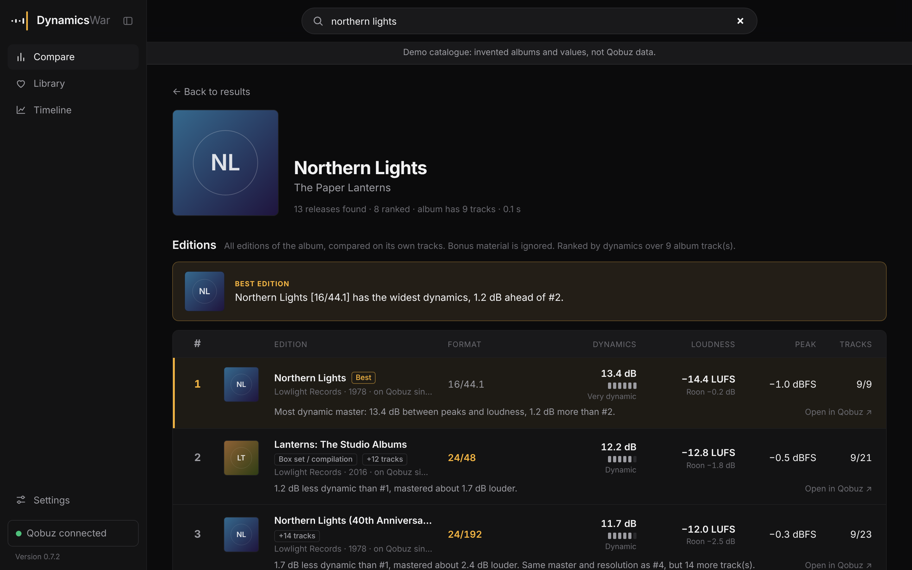
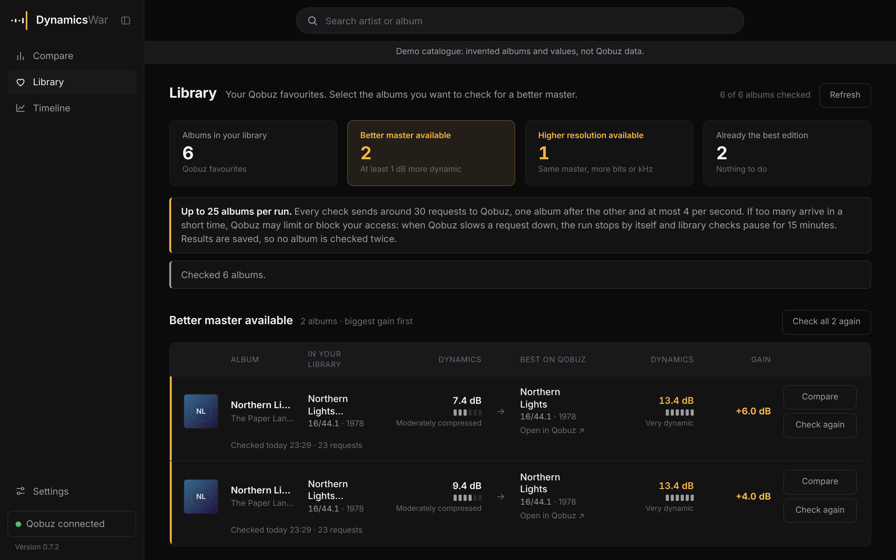
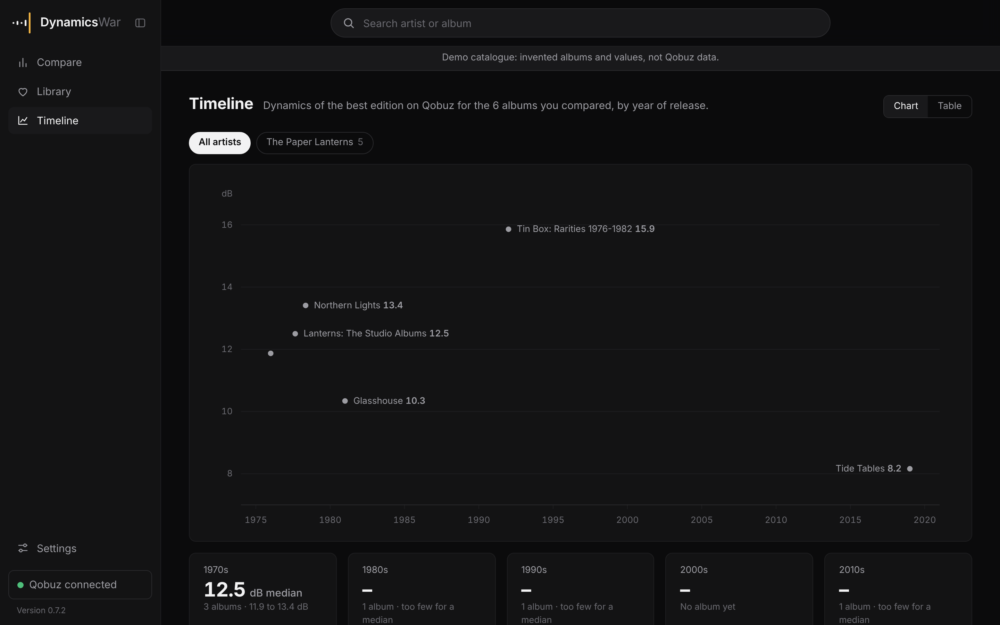
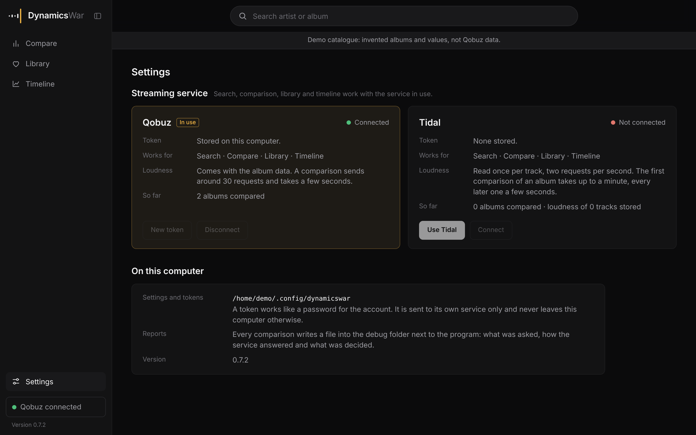

# DynamicsWar

Finds the best-sounding edition of an album on Qobuz (and, in a test phase, on Tidal): it compares the dynamics of every
edition and shows which master wins, and why.

*The screenshots show the demo mode (`--demo`) with its invented catalogue.*

## Read this first:

DynamicsWar is a private hobby project. It is not affiliated with, endorsed by or supported by
Qobuz, Tidal or Roon; all names belong to their owners.

- It talks to the interfaces the services' own web players use. These are not public APIs: they
  can change or be closed at any time, and using them with third-party software may be against
  a service's terms of use. You use DynamicsWar with your own account and at your own risk.
- It reads metadata only: titles, lengths, ISRC, loudness, peak level and format. It never
  downloads, records or stores audio.
- Everything stays on your computer. There is no server, no shared database and no telemetry;
  your access tokens are kept in your user profile and are sent to nobody but the service they
  belong to.
- It only reads your library and never changes it.
- Nothing is bundled: you bring your own account and your own token.

If you speak for one of the services and want something changed or removed, please open an issue.

## Start

Double-click `DynamicsWar.pyw` (or `Start DynamicsWar.bat` if nothing happens).
Needs Python 3.8 or newer, no extra packages. The window is Microsoft Edge in app mode.

    python -m dynamicswar            start from a console
    python -m dynamicswar --demo     try the interface with an invented catalogue, no account

The app runs once: a second start shows the window of the running one. If the app was updated
while it was open, the next start ends the running version and takes its place.

On first start the app asks for the access token from the Qobuz web player (instructions in
the dialog). It is stored in your user profile (`%APPDATA%\DynamicsWar\config.json`), never in
this folder.

## How it decides

- Qobuz stores loudness (ReplayGain) and peak level per track. Dynamics = peak minus loudness.
  No audio is downloaded.
- Every release is checked against the album's own track list. All editions of the album -
  standard, deluxe, anniversary, box set - go into one ranking, compared on the album's own
  tracks only. Live, mono and remixed versions, singles and other albums are listed but not
  ranked. Re-recordings are ranked and marked.
- A release is an edition of the album when it holds (nearly) all of the album's tracks as the
  same recordings - same ISRC or same length within 3 s. That admits deluxe editions and box
  sets and keeps out compilations, live albums and bootlegs, whatever they are called.
- Editions with the same master are ordered by resolution, then by number of tracks (more
  content wins); box sets stand behind editions carrying the album's name.
- Releases that are no edition but hold at least two album tracks as the very same recording
  (same ISRC), on average 1 dB or more dynamic than the best edition, are shown separately as
  "Better masters of single tracks".
- Each comparison writes a report to `debug/` (what Qobuz offered, what was taken, timings, and
  under `traffic` how Qobuz answered: status codes, throttled requests (HTTP 429) per endpoint,
  retries, waiting time, the highest number of requests within one second, rate-limit headers).

## Library

The Library tab lists the albums you marked as favourites on Qobuz and checks, on request,
whether a better master exists. It only reads the library and never changes favourites.

- Tick the albums to check: at most 25 per run, one album after the other, at most 4 requests
  per second (2 in parallel instead of 6, one second between albums).
- A check is the same comparison as in the search. Result: better master (1 dB or more),
  same master in a higher resolution, already the best edition, or not comparable.
  A box set or compilation that is the only release of its name is listed as not comparable:
  it is compared as a whole, the albums on it are not checked one by one.
- When Qobuz throttles a request (HTTP 429) the run stops at once, nothing more is sent and
  library checks pause for 15 minutes.
- Results are kept in `%APPDATA%\DynamicsWar\library.json`, so no album is checked twice
  by accident. "Check again" on a row checks that album again; the button of a group checks
  its albums again, oldest result first, at most 25 per run. A result stays until the new
  one is in. Each run writes `debug/_library run <date>.json`.

## Timeline

The Timeline tab plots every album compared so far: year of release against the dynamics of
its best edition. An artist can be highlighted, a point opens the comparison, and there is a
table view. The entries are kept in `%APPDATA%\DynamicsWar\history.json`; on first use the
reports in `debug/` are read in (and replayed with the current rules), so earlier comparisons
are there from the start. It shows the best edition available today, not the mastering of
the time, and only the albums you compared.

## Settings and Tidal (test phase)

The Settings tab (bottom left) lists the two services, Qobuz and Tidal: whether each is connected,
which one is in use, and buttons to connect, disconnect and switch. Search, comparison, library
and timeline work with the service in use; the choice is kept between starts. Switching is not
possible while a comparison or library check is running. The timeline shows what was compared on
the service in use.

The library works for both services, with separate result files (`library.json`,
`library-tidal.json`). On Tidal a run is limited by the delicate requests rather than by albums:
it ends by itself after about 300 loudness requests and stops at once when Tidal turns one down.
A "better master" of less than 2 dB between a 176.4/192 kHz release and another resolution is
marked as uncertain: Tidal's loudness values for such releases came out about 1 dB too loud in the
two albums that could be checked against Qobuz.

`python -m dynamicswar --service tidal` starts a second window with Tidal as the service, next to
the normal one - useful for looking at the same album on both services side by side.

The token comes from the Tidal web player (instructions in the dialog), is stored next to the
Qobuz one in `config.json` and expires after a while.

Tidal's catalogue calls give the peak of each track. Loudness per track and the exact format only
come with the request the player sends before it plays a track. DynamicsWar first finds the
editions (titles, lengths and ISRCs are enough for that) and then sends that request only for the
album's own tracks on those editions - not for bonus material and not for compilations or live
albums that merely were candidates. Once per track, at most two per second, at most 200 per
comparison; a running comparison can be stopped. It keeps the values in `%APPDATA%\DynamicsWar\tidal.json`,
so a track is never asked for twice. The first of these requests that Tidal turns down stops them
for 15 minutes; the comparison ends with a message and `debug/_tidal refused <date>.json` says how
Tidal answered. The answer also carries the access to the stream - it is dropped at once, never
stored, and no audio is loaded. All other requests are limited to four per second.

Reports of Tidal comparisons are named `<artist> - <album> [tidal].json`, so they stand next to
the Qobuz report of the same album. Values of the two services are not on exactly the same scale
(measured: -0.6 to +0.9 dB per album for the same master); the app does not compare across
services.

## Layout

    dynamicswar/core.py       engine: access to Qobuz, title matching, dynamics
    dynamicswar/client.py     what every service shares (request log, rate limit) and the Qobuz service
    dynamicswar/tidal.py      the Tidal service: same methods, albums in the same form
    dynamicswar/discover.py   search grouping and finding all editions (parallel)
    dynamicswar/editions.py   standard / expanded / not ranked, reasons in plain English
    dynamicswar/library.py    favourites, result of a check, stored results
    dynamicswar/history.py    what was compared so far, for the timeline
    dynamicswar/server.py     local server (127.0.0.1 only) behind the interface
    dynamicswar/app.py        start-up and window
    dynamicswar/web/          interface
    tests/                    python -m unittest discover -s tests

## License

MIT, see `LICENSE`. The software comes without any warranty.
